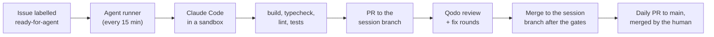

# Commet

[](https://github.com/ephemerallyCaden/qodo-2026/actions/workflows/ci.yml)

Commet is a local-first, pixel-art 3D map of your codebase, for developers whose AI coding agents now write much of their code: the repo is a star, its folders are planets, and its files are settlements on their surface. Fog of war covers the code you haven't reviewed, in three levels (fogged, misted, clear), each agent session that edited the repo flies as a drone, and your teammates from git history ride along in a crew spaceship.


**Contents**

- [Getting started](#getting-started)
- [What you see](#what-you-see)
- [Commands](#commands)
- [Privacy](#privacy)
- [Status](#status)
- [The software factory](#the-software-factory)
- [Daily hackathon posts](#daily-hackathon-posts)
- [Who wrote what](#who-wrote-what)
- [Docs](#docs)
- [License](#license)

## Getting started

Requires Node 20.19+, npm, git and a browser with WebGL.

```sh
git clone https://github.com/ephemerallyCaden/qodo-2026.git commet
cd commet
npm ci
npm run build
alias commet="node $PWD/dist/cli.js"
```

Then map any git repository with full history:

```sh
cd path/to/your-repo
commet scan
commet open
```

`commet scan` prints what it found (commits by author class, agent sessions, planets and their health) and ends with:

```text
snapshot written to <git-common-dir>/commet/snapshot.json (…)
layout written to <git-common-dir>/commet/layout.json (…)
```

`commet open` starts the view on a free port and opens your browser:

```text
Commet is open at http://127.0.0.1:<port>/#t=<token>
Watching HEAD and branches: a commit, checkout, merge, rebase or fetch rescans, and the view follows.
Serving on 127.0.0.1 only. Press Ctrl+C to stop.
```

- At a terminal, the first scan suggests your main code folder (such as `src`) and asks you to confirm it. Its subfolders become the inner planets. `--root <dir>` or `--no-root` sets it without asking.
- A first run fogs every change you didn't provably write. `commet chart baseline` marks everything up to HEAD as read, so only later changes are fogged; `commet chart baseline --undo` takes it back.
- Drones come from the Claude Code session logs on this machine (`~/.claude`, or `CLAUDE_CONFIG_DIR`). A fresh clone of someone else's repo has none, so it shows no drones and every commit as unknown.
- Shallow clones are refused with exit code 3. Run `git fetch --unshallow` first.
- `commet open --no-open` prints the URL without starting a browser, which keeps the token out of process lists. `--port <n>` picks the port.

Nothing leaves your machine. Commet reads local git history and agent logs, writes only to `.git/commet/` (and to your hooks, if you install them), and has no telemetry ([Privacy](#privacy)).

## What you see

In the view: `drag: look · wasd: fly · r f: up down · [ ]: planets · esc: free flight`.

- The star is the repo. Each top-level folder with code is a planet, second-level folders are continents, files are settlements, and test files are moons of the planet they test.
- A planet's look is its code health, in four bands from healthy to ash, toxic and lava. The bands come from debt markers (`TODO`, `FIXME`, `HACK` and `XXX` per 1,000 lines) and, with `commet scan --with-qodo`, open Qodo review findings.
- Fog has three levels. Fogged clouds cover any file with a change you didn't write (an agent's, a teammate's, or one Commet can't attribute) that you haven't reviewed since. A thin mist means you've read it: you opened its whole diff in the review panel, charted it, or set a baseline. Clear will mean you understood it, by passing a quiz on that version. The quizzes aren't built yet ([#203](https://github.com/ephemerallyCaden/qodo-2026/issues/203)), so today no file is clear. Each planet shows a mastery % (clear files over all files), which stays at 0% until then.
- Each Claude Code session that edited the repo is a drone circling the planet it worked on most. Click one to see the files that session edited and when, with its branch and model.
- Every human author in the scan window rides in the crew spaceship (up to 16, the rest shown as +N), with you as captain in the gold cap. Click a porthole to see the planets and files that person touched.
- Lines between files show co-change constellations: files that usually change together in git history. A teal flag marks a file whose usual partner changed recently without it.
- The `files` toggle opens a folder tree beside the map, with each file's fog level and each folder's mastery %.
- Charting a file can leave a one-line captain's log note pinned to it.

<p>


</p>

The Day 15 video walks through the map and one ticket's trip through the factory:

https://github.com/user-attachments/assets/dc3eb9dd-2d00-4539-a404-69b487d5cfdb

## Commands

| Command | What it does |
|---|---|
| `commet scan [--window <months>] [--with-qodo] [--root <dir>] [--out <file>]` | Reads git history and agent logs, writes `snapshot.json` and `layout.json` to `.git/commet/`. The same repo and logs always give byte-identical output. |
| `commet open [--port <n>] [--no-open]` | Serves the view on 127.0.0.1 and rescans after each commit, checkout, merge, rebase or fetch. |
| `commet chart status` | Lists each planet's files by fog level, with its mastery %. |
| `commet chart [--note <text>] <file>` | Marks a file as read (misted), optionally with a captain's log note. |
| `commet chart baseline [--undo]` | Marks everything up to HEAD as read, or undoes that. |
| `commet beacon [list]`, `commet beacon <file> <note>` | Lists, adds or removes captain's log notes. |
| `commet hook install [--yes]`, `commet hook remove` | Adds git hooks that refresh the snapshot and a Claude Code hook that records edit hashes. Asks first and chains any existing hook. |

Exit codes: 0 ok, 1 internal error, 2 usage, 3 shallow clone, 4 not a repo or no HEAD, 5 state error, 6 the server couldn't bind, 7 hook install not confirmed.

## Privacy

- No telemetry, no uploads, no remote server. The only server is `commet open`, bound to 127.0.0.1. It rejects requests whose Host header isn't 127.0.0.1 or localhost, requires the per-launch token from the URL, and sends no CORS headers.
- Agent logs are read through a field allowlist. Prompt and message text are never read or stored, edits are kept only as line hashes, and the snapshot holds no absolute paths ([AGENTS.md Rule 2](AGENTS.md#rule-2-private-by-construction), checked by `test/privacy.test.ts`).
- `commet scan --with-qodo` is the one network opt-in: it reads this repo's PRs and Qodo findings through your `gh` and `qodo` CLIs, read-only. Without the flag, a scan makes no network calls.
- State files in `.git/commet/` are written with mode 0600 and never pushed. Captain's log notes live there too, not in git notes.

## Status

Active hackathon project, built solo for Qodo's "Build a Software Factory in 30 Days" (Nov 2 – Dec 2, 2026). Work lands on the `session/week1` branch through reviewed task PRs and reaches `main` in daily PRs.

Works today: the scanner and agent attribution, the 3D view with health looks and orbits, fog with the review panel and mastery % (fogged and misted; clear needs the quizzes), per-session drones, the crew spaceship, co-change constellations, the directory view, captain's log notes, live rescans and the optional hooks. Agent attribution reads Claude Code logs only.

Next, from [understanding mode](docs/features/understanding-mode.md): quizzes that clear fog ([#203](https://github.com/ephemerallyCaden/qodo-2026/issues/203)), written by your own coding agent after a one-time opt-in ([#202](https://github.com/ephemerallyCaden/qodo-2026/issues/202)), call-chain quizzes ([#204](https://github.com/ephemerallyCaden/qodo-2026/issues/204)) and on-demand summaries of a teammate's work ([#208](https://github.com/ephemerallyCaden/qodo-2026/issues/208)).

## The software factory

Commet is built by a factory of Claude Code agents, project rules, CI and Qodo review. A team lead session plans tasks and gives each one to an agent in its own git worktree; every task becomes a PR that Qodo reviews; the lead merges into the session branch once the gates pass; only the human merges `main`.



| Piece | What it does | Where |
|---|---|---|
| Agent runner | A launchd job takes the oldest issue labelled `ready-for-agent`, runs Claude Code in a sandbox with no credentials and no network beyond localhost, runs the checks, opens a PR, then works through Qodo's findings. Labels track it (`agent-working`, then `agent-done` or `agent-needs-help`). It never merges or pushes `main`. Example: [PR #216](https://github.com/ephemerallyCaden/qodo-2026/pull/216) for ticket [#209](https://github.com/ephemerallyCaden/qodo-2026/issues/209). | [`factory/`](factory), [AGENTS.md](AGENTS.md#agent-runner-factory), [feature doc](docs/features/agent-runner.md) |
| Definition of done | Every valid High or Medium Qodo finding is fixed with a test that fails first, or disputed with evidence recorded in Qodo. A skipped review never counts as clean, and the reviewed commit must be the PR's head. | [AGENTS.md](AGENTS.md#definition-of-done-the-saved-quality-gate) |
| House rules | Seven numbered rules, each with its reason and how it is checked (a test, a lint rule or review): evidence or unknown, private by construction, same input same output, pixel honesty, palette consistency, understanding not output, NUL-framed git output. | [AGENTS.md](AGENTS.md), [CONSTITUTION.md](CONSTITUTION.md) |
| `visual-proof` | For a view change: builds the base and the head, films the same scene from the same data, takes every capture twice and requires the takes to match pixel for pixel, scans the frames for private data, and writes a text summary Qodo can read, since Qodo can't see images. | [`.claude/skills/visual-proof`](.claude/skills/visual-proof/SKILL.md) |
| `fix-proof` | Removes a fix's logic on a scratch branch and records which of its tests fail, then restores it. A test that still passes without the fix doesn't test the bug. | [`.claude/skills/fix-proof`](.claude/skills/fix-proof/SKILL.md) |
| Findings sweep | Each runner tick groups Qodo findings from the owner's PRs and local reviews by the mistake they make. A mistake seen 3 times across 2 tickets opens a [`rule-proposal`](https://github.com/ephemerallyCaden/qodo-2026/issues?q=label%3Arule-proposal) issue with a draft rule; the human adopts or closes it. | [`factory/`](factory), [feature doc](docs/features/repeat-findings.md) |
| Agent roles and guards | Feature agents, debuggers, scouts and bar-raisers each have a prompt, and a hook checks every shell command they run: feature agents can't push, merge, open or close PRs and issues, move branches, run git aliases or publish, and scouts run only read-only commands. | [`.claude/agents/`](.claude/agents), [`.claude/hooks/agent-guard.mjs`](.claude/hooks/agent-guard.mjs) |
| CI | Build, typecheck, lint and tests on Node 20 and 22, plus render tests and golden images under SwiftShader, on every PR and session-branch push. | [`.github/workflows/ci.yml`](.github/workflows/ci.yml) |

## Daily hackathon posts

| Day | Challenge | My post |
|---|---|---|
| 1 | Your factory’s first delivery | [My project: Commet](https://github.com/orgs/qodo-hackathon/discussions/2#discussioncomment-19408392) |
| 2 | Your factory, your rules | [My factory's house rules](https://github.com/orgs/qodo-hackathon/discussions/4#discussioncomment-19429326) |
| 3 | Connect your factory to the backlog | [Ticket → branch → PR](https://github.com/orgs/qodo-hackathon/discussions/5#discussioncomment-19536827) |
| 4 | Automate your factory’s first job | [It runs in my sleep now](https://github.com/orgs/qodo-hackathon/discussions/6#discussioncomment-19550653) |
| 5 | Make your factory self-improve | [Improving the continuous-improver](https://github.com/orgs/qodo-hackathon/discussions/7#discussioncomment-19553529) |
| 6 | Ask your codebase before you build | [Wisdom caught a bug in my drones feature](https://github.com/orgs/qodo-hackathon/discussions/8#discussioncomment-19685476) |
| 7 | Close the feedback loop | [Every agent session is a drone now](https://github.com/orgs/qodo-hackathon/discussions/9#discussioncomment-19761460) |
| 8 | Review before you commit | [Leave a note on a planet](https://github.com/orgs/qodo-hackathon/discussions/10#discussioncomment-19761464) |
| 9 | Set up quality gates | [A saved quality gate for the drone panel](https://github.com/orgs/qodo-hackathon/discussions/11#discussioncomment-19773624) |
| 10 | Factory with verification | [One ticket, every gate](https://github.com/orgs/qodo-hackathon/discussions/12#discussioncomment-19782490) |
| 11 | make the reviewer yours | [Telling the reviewer how my project works](https://github.com/orgs/qodo-hackathon/discussions/13#discussioncomment-19820999) |
| 12 | Give your factory the full picture | [Orbiting planets](https://github.com/orgs/qodo-hackathon/discussions/14#discussioncomment-19821076) |
| 13 | Teach your factory a new skill | [The visual-proof skill: the drone is always visible](https://github.com/orgs/qodo-hackathon/discussions/15#discussioncomment-19829408) |
| 14 | Turn your quality gate into a workflow. | ["Qodo Approved" label and another human gate](https://github.com/orgs/qodo-hackathon/discussions/16#discussioncomment-19822697) |
| 15 | Show your factory | [Video demo](https://github.com/orgs/qodo-hackathon/discussions/17#discussioncomment-19830417) |
| 16 | Scan your repo with Arnica | [Getting Arnica to see my repo](https://github.com/orgs/qodo-hackathon/discussions/18#discussioncomment-19837727) |
| 17 | What did your agent decide? | [Fog and mist now signal levels of understanding](https://github.com/orgs/qodo-hackathon/discussions/19#discussioncomment-19906838) |
| 18 | Turn a red build into useful feedback | [The spaceship's first red build](https://github.com/orgs/qodo-hackathon/discussions/20#discussioncomment-19915277) |

## Who wrote what

The code is written by AI coding agents under the factory's gates above, with the human's decisions recorded in the PRs and issues. The daily posts were drafted by my AI agents from the factory's own records (PRs, reviews, CI runs), then edited and posted by me.

## Docs

- [CONSTITUTION.md](CONSTITUTION.md): product principles, what agents may do alone, and the quality gates.
- [AGENTS.md](AGENTS.md): house rules for every coding agent and for Qodo. [CLAUDE.md](CLAUDE.md) adds the build commands and layout notes for Claude Code.
- [docs/features/](docs/features): one doc per feature, with requirements and their status.
- [docs/design/art-direction.md](docs/design/art-direction.md): the pixel-art spec, including what every visual channel encodes.
- [docs/contracts/phase2.md](docs/contracts/phase2.md): the snapshot, layout, fog and local API contracts.

## License

This repository has no license file, so default copyright applies: ask the author before reusing the code.
