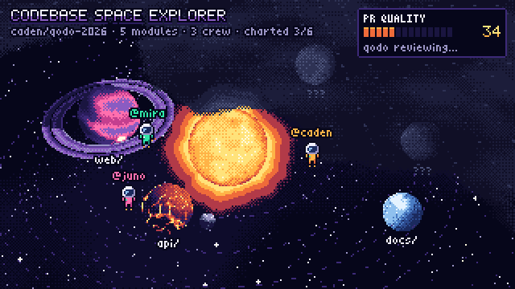

# Day 1 hype GIF: Codebase Space Explorer

A 6-second seamless loop of one scene from the Codebase Space Explorer concept. The repo is a star, its top-level modules are planets, contributors are astronauts, and a merged PR with a clean Qodo review clears the fog off one more sector.



| File | What |
|---|---|
| `hype.gif` | 640×360, 20 fps, 120 frames, 6 s, loops forever (about 0.7 MB) |
| `poster.png` | 1280×720 still of frame 54 (toast up, `infra/` just revealed) |

## Regenerate

```sh
npm install      # three + playwright, local to this folder
npm run render   # writes frames/, hype.gif, poster.png
```

It needs the Playwright 1.64 Chromium build (`npx playwright install chromium` if `~/Library/Caches/ms-playwright/chromium-1248` is missing) and ffmpeg at `/opt/homebrew/bin/ffmpeg`. Set `FFMPEG=/path/to/ffmpeg` to override the ffmpeg path.

For quick looks while tweaking: `node render.mjs --only 0,54,90` renders just those frames, writes 4× previews to `frames/preview-NNNN.png`, and prints the computed orbit layout.

## How it works

- **`scene.js`**: three.js renders the system into a 320×180 render target with nearest filtering. Every surface shader (star, planets, ring, corona) picks its colour from a short palette ramp with a 4×4 Bayer dither, so pixels come out as palette colours instead of blended ones.
- **Post pass**: adds the starfield and nebula, works out each pixel's position on the orbital plane to apply fog of war by angular sector, burns the dissolving fog edge in mint during the reveal, then snaps every pixel to the 29-colour palette.
- **2D overlay**: astronaut sprites (`sprites.js`), labels and the HUD are drawn per pixel with a hand-made bitmap font (`font.js`: 5×7 caps, 3×5 micro with lowercase). No web fonts and no anti-aliasing.
- **Determinism**: everything is a function of the frame index. All motion is periodic over the loop (whole turns, even blink counts, noise sampled on a circle in time), so frame 120 equals frame 0. There's no `Math.random`. Two runs produce byte-identical frames.
- **`render.mjs`**: launches headless Chromium (SwiftShader WebGL) and serves this folder through Playwright request interception, so no socket is opened and any non-local request is aborted. It calls `hype.renderFrame(i)` for each frame, saves the 320×180 PNG, and has ffmpeg nearest-neighbour upscale 2×, then `palettegen` + `paletteuse=dither=none`.

Planet positions are art-directed in screen pixels (`sx`, `sy` in `MODULES`) and projected back onto the orbital plane. Move a planet by editing those values. The fog arc constants (`FOG_LO`, `FOG_CLOSED`, `FOG_OPEN`) are angles on that plane; `--only` prints each planet's angle so you can keep hidden planets inside the arc.

`index.html` also plays the loop live if you serve this folder with any static server.

## Timeline (loop phase 0–1)

| Phase | Beat |
|---|---|
| 0.00–0.22 | Qodo reviewing; PR QUALITY climbs 34 → 92 |
| 0.22 | Merge: the meter flashes and the toast slides in |
| 0.25–0.47 | Fog pulls back across `infra/`, with a ping ring, "+1 SECTOR" and charted 3/6 → 4/6 |
| 0.74 | Toast slides out |
| 0.80–0.99 | "next PR: in review"; the meter drains and the fog drifts back in to close the loop |
